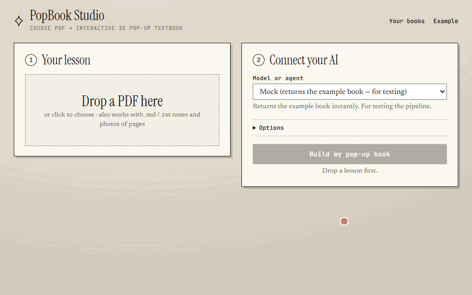
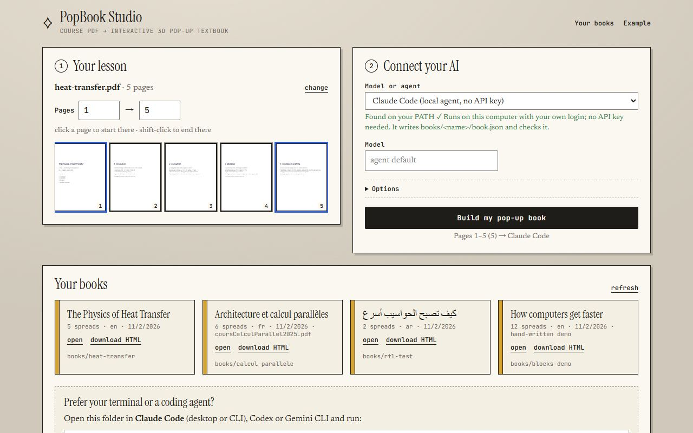
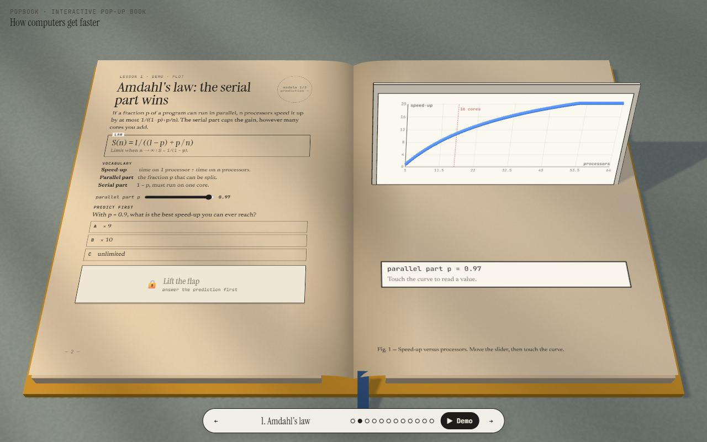
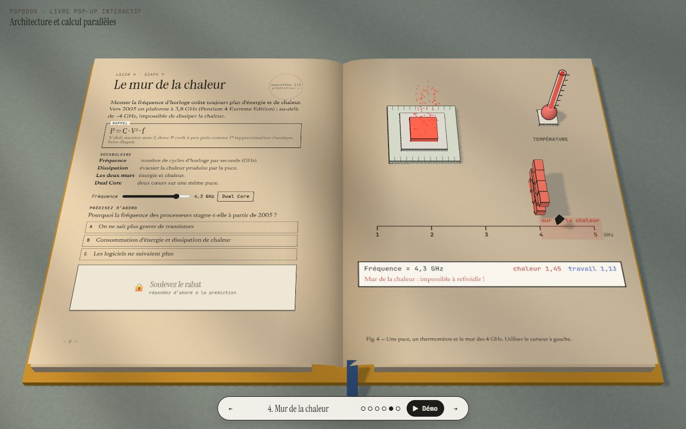
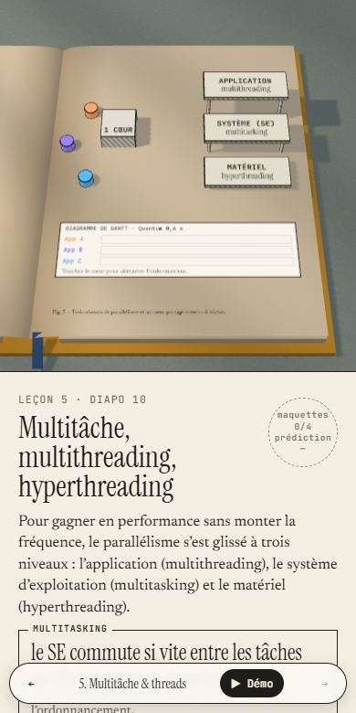

# PopBook Studio

[](https://github.com/AlphaaCode/Popbook/actions/workflows/ci.yml)
[](LICENSE)

[](CONTRIBUTING.md)

Turn any course PDF into an **interactive 3D pop-up textbook** in your browser, using your own AI: an API key, a
local model, or a coding agent such as Claude Code. Inspired by *Every Joule* by Techartist.



Each spread is a lesson. The **left page** is printed text: concept, key formula, vocabulary, a *predict first* quiz
and a lift-the-flap answer. The **right page** holds a paper-craft 3D model you poke at to see the idea work.
Answer the quiz and touch every part of the model, and the lesson gets its stamp.

> **Not a developer?** The [**beginner's guide (PDF)**](docs/PopBook-Beginners-Guide.pdf) explains every step —
> installing Node.js, downloading PopBook, connecting an AI and making your first book — with no coding needed.

| | |
|---|---|
|  |  |
|  |  |

## Quick start

You need **Node.js 18.17 or newer**.

```bash
git clone https://github.com/AlphaaCode/Popbook.git
cd Popbook
npm install
npm start
```

Open **http://localhost:5173**, then:

1. **Your lesson.** Drop a PDF (or `.md` / `.txt` notes, or photos of pages). Click a thumbnail to start the range
   there; shift-click to end it.
2. **Connect your AI.** Pick a provider (see below) and paste a key if it needs one.
3. **Build.** Follow the live log, then *Open the book* or *Download as one HTML file*.

Two books ship with the repo: `calcul-parallele`, a French parallel-computing course, and `blocks-demo`, which uses
every scene block. Open them from *Your books* or directly at
`http://localhost:5173/viewer/?book=blocks-demo`.

## How it works

The AI never writes 3D code. It writes one file, `book.json`, in a strict format
([`prompts/core.md`](prompts/core.md) and one [`prompts/blocks/<name>.md`](prompts/blocks) per scene block are exactly what the model reads). A hand-written engine renders any valid
book, so results stay reliable even with small models.

```
pages ──► outline call ──► [review] ──► one call per 2–3 spreads (3 at a time) ──► autofix + validate ──► book.json ──► 3D viewer
```

With an API, one call reads every page and plans the book (an outline: which pages, which scene block, what each spread
teaches); tick *let me review the outline* to edit, reorder or delete its spreads first. The spreads are then written
two or three neighbours per call, which gets only their pages and their blocks' specs. Every spread is fixed in code first
(`lib/autofix.js`) and checked on its own; one that still fails validation is sent back alone with its errors, then to the
planner model once, and if it still fails
PopBook writes that spread itself from the page text and flags it ⚠ in *Your books*, where any spread can be
regenerated. Valid answers are kept in `.cache/`: the same pages with the same prompts and model cost nothing the
second time. Agents (Claude Code, Codex, Gemini CLI) write the whole book in one session instead, from a bundle the studio
prepares (see *Local agents* below).

## AI options

| Option | What you need | Default model | What gets sent |
|---|---|---|---|
| **Claude API** | `ANTHROPIC_API_KEY` | `claude-opus-5-5` | page text + images of figure pages (the PDF itself at high fidelity); answers through a forced tool |
| **OpenAI API** | `OPENAI_API_KEY` | `gpt-6-astra` | page text + images of figure pages; strict JSON schema |
| **Gemini API** | `GEMINI_API_KEY` | `gemini-4-argon` | page text + images of figure pages (the PDF itself at high fidelity); JSON schema |
| **OpenAI-compatible** | a base URL (+ key if the server wants one) | `qwen2.5:14b` | text, plus figure images if you tick *send page images* (vision models only); JSON schema |
| **Claude Code, prompt only** | `claude` on your PATH, logged in | `opus` (plans), `haiku` (writes) | page text, one `claude -p` per call, no tools; JSON schema |
| **Claude Code** | `claude` on your PATH, logged in | `sonnet` (Balanced) | `books/<slug>/input/`; the agent works in the repo folder |
| **Codex CLI** | `codex` on your PATH | the CLI's default | same |
| **Gemini CLI** | `gemini` on your PATH | `gemini-4-argon` (Balanced) | same |

**Presets.** *Budget*, *Balanced* and *Best* pick the path and the models instead of you. Budget takes the cheapest path:
one call writes the whole book (one per 15 pages), with all the rules and every block's spec; no outline, so no outline review
and no *regenerate this spread*. Balanced and Best take the staged path: the **planner** writes the outline (one call), the
**writer** the spreads (2–3 per call, the bulk of the tokens). A new build starts on Budget with Gemini and local models
(OpenAI-compatible servers), on Balanced with the others; the job log and the estimate name the path and count the requests.
Gemini's free tier allows 5 requests a minute and 20 a day per model: PopBook spaces requests to Gemini (and to
OpenAI-compatible servers) 13 s apart, writes their staged spreads one call at a time, and stops with a clear message when the
daily limit is reached.

| Preset | Path | Planner | Writer | Figure images |
|---|---|---|---|---|
| Budget | one call per 15 pages | — | cheap model, low reasoning | yes |
| Balanced | outline, then writers | default model, medium reasoning | cheap model, low reasoning | yes |
| Best | outline, then writers | default model, medium reasoning | default model, medium reasoning | yes |

The cheap model is a known cheaper sibling (`gemini-3.8-flash`, `claude-haiku-5-5`, `haiku`), else the default model.
`PLANNER_MODEL` / `WRITER_MODEL` in `.env` override a role and may send it to another provider: a known model id
(`claude-opus-5-5` uses `ANTHROPIC_API_KEY`) or `provider:model` (`compat:llama3:8b`). The studio's *planner model* and
*writer model* fields override both. Models, prices and what each model accepts live in [`lib/models.js`](lib/models.js).

**Structured output.** Every staged call sends the JSON schema of its answer, generated from the shape table in
[`lib/validate.js`](lib/validate.js): the outline's, or the writer's for the book's blocks (Budget sends none: a schema of
every block would outweigh their specs). Small local models gain the most:
Ollama turns the schema into its `format`, llama.cpp into a GBNF grammar, so the answer cannot leave the shape. A server
that refuses the schema is asked again without it.

**Keys.** Put them in `.env` (copy [`.env.example`](.env.example)) or paste them in the studio. A pasted key is
sent only to the local server for that job and is never written to disk. Tick *remember on this computer* to keep it
in this browser's localStorage.

**Models.** Defaults come from `.env` (`ANTHROPIC_MODEL`, `OPENAI_MODEL`, `GEMINI_MODEL`, `COMPAT_MODEL`) and can
be changed per build in the studio. The defaults are each provider's current flagship with PDF or image input (checked November 2026); `claude-sonnet-5-5` is a cheaper Claude option. Stronger models make better books, especially for picking scene blocks and
writing faithful, concise text.

**OpenAI-compatible base URLs:**

| Server | Base URL |
|---|---|
| Ollama | `http://localhost:11434/v1` |
| LM Studio | `http://localhost:1234/v1` |
| OpenRouter | `https://openrouter.ai/api/v1` |
| Groq | `https://api.groq.com/openai/v1` |

**Local agents.** The studio finds `claude`, `codex` and `gemini` on your PATH and runs them in the repo folder.
It first writes `books/<slug>/input/`: `pages.md` (every page's text), `fig-<n>.jpg` (the figure pages) and, when a plain
model of the same family can plan (`claude -p`, or the Gemini / OpenAI API with a key), `outline.json`. `PROMPT.md` then
names exactly the files to read and forbids opening the PDF or exploring the repo. The agent writes
`books/<slug>/book.json`, runs the checker and fixes its own errors; its output streams into the build log. Claude Code runs with
`--permission-mode acceptEdits --allowedTools "Read,Write,Edit,MultiEdit,Glob,Grep,Bash(node tools/check.mjs:*),Bash(node tools/pdf2pages.mjs:*)"`.
To change a command, set `AGENT_CMD_CLAUDE`, `AGENT_CMD_CODEX` or `AGENT_CMD_GEMINI` in `.env`; the prompt is
appended as the last argument.

**Testing without any AI:** `POPBOOK_MOCK=1 npm start` adds a *Mock* provider that returns the example book.

## Cost

Measured with `npm run eval` on pages 1–10 of two course PDFs, one run each (`eval/`); the studio's estimate predicts them
for your own pages before you build.

**Gemini, gemini-3.8-flash: v0.1 vs the single-call path** (Budget's path, measured when it was built):

| PDF | v0.1 | v0.2 single call | |
|---|---|---|---|
| Claude-Call-Me-Guide | $0.047 · 14.3k in / 9.6k out | $0.015 · 13.8k in / 1.3k out | 3.1× cheaper |
| coursCalculParallel2025 | $0.046 · 10.1k in / 10.2k out | $0.017 · 8.6k in / 2.7k out | 2.7× cheaper |

Most of the saving is output: v0.1 let the model think at will. Budget's length guidance, added since, made one book's output
46 % longer on gemini-3.6-flash, which thinks at its own default level.

**Claude Code (`claude -p`), haiku for every role: Budget vs Balanced.** Your Claude plan pays, so tokens only:

| PDF | Budget | Balanced |
|---|---|---|
| Claude-Call-Me-Guide | 1 request · 13.3k in / 9.4k out · 44 s · 6 spreads | 4 requests · 38.3k in / 17.0k out · 61 s · 8 spreads |
| coursCalculParallel2025 | 1 request · 7.8k in / 10.7k out · 47 s · 5 spreads | 3 requests · 34.5k in / 18.0k out · 82 s · 5 spreads |

Free Gemini keys allow about 20 requests a day per model; one 10-page book uses 1.

Untested: caching and cost on the Claude API and OpenAI with real keys. The figures above are Gemini and `claude -p` only.

## Agent mode (no studio)

Open this folder in Claude Code (CLI or desktop) and run:

```
/popup-book path/to/lesson.pdf 1-10
```

Or ask any coding agent to "follow AGENTS.md to make a pop-up book from lesson.pdf, pages 1–10". By hand:

```bash
node tools/pdf2pages.mjs lesson.pdf --pages 1-10 --out books/my-lesson   # text per page + source.pdf
# write books/my-lesson/book.json following prompts/core.md and prompts/blocks/
node tools/check.mjs books/my-lesson                                     # repeat until OK
open http://localhost:5173/viewer/?book=my-lesson
```

Agents may also write **custom scenes**, hand-made 3D modules, when no built-in block fits an idea. `CLAUDE.md`
documents the kit API; [`books/blocks-demo/scenes/pendulum.js`](books/blocks-demo/scenes/pendulum.js) is an example.

## Scene blocks

| Block | The idea is about… | The reader… | Stamp targets |
|---|---|---|---|
| `race` | A vs B on up to 4 cases | starts a simulated clock; two shelves of glass jars fill (cubic time-lapse), a card shows elapsed time and % per machine | each item id |
| `bars` | growth over ordered items | grows the towers, flips log/linear; optional dashed growth law v₀·factor^((x−x₀)/every) | `play`, `bar`, `scale` |
| `model` | a knob that drives an outcome with a limit | drags a slider that drives formulas, flips a toggle, hits a glowing threshold wall; visuals `chip` (dies, heat particles, thermometer), `tank`, `dial` | `param`, `threshold`, `toggle` |
| `plot` | exploring y = f(x, p) | moves a parameter that rebuilds a 3D curve on a standing panel, clicks the curve to read values | `param`, `curve` |
| `flow` | a pipeline or algorithm | sends a glowing token through step blocks, or clicks steps | `play` + step ids |
| `stack` | levels of abstraction | clicks stepped floors to read each | level ids |
| `scheduler` | sharing one resource | starts a core that serves task tokens, live Gantt chart, quantum slider, optional hyperthreading and levels | `core` + level ids |
| `network` | connected machines | sets packets flowing between racks and a switch | `network` |
| `showcase` | 1–4 objects or domains | clicks procedural models: globe (grid refines per step), head (scan slice), layers (geology + wells), server, chip, molecule, dna, gear, flask, cube, pyramid, sphere, cylinder | each item id |
| `custom` | anything (agent mode only) | whatever the module does | declared by the module |

Model expressions (`expr`, `when`) use a small safe evaluator ([`lib/expr.js`](lib/expr.js)): numbers,
`+ − * / % ^`, comparisons, `&& || !`, `?:`, `min max abs sqrt log log10 log2 exp pow round floor ceil sin cos tan`,
`pi`, `e`. There is no `eval`.

### Adding a new block

1. **Engine:** write `function myblock(sc, ctx) { … return { G, pops, update, controls, demo } }` in
   [`viewer/blocks.js`](viewer/blocks.js) and add it to the `BLOCKS` export. Use the helpers from
   [`viewer/kit.js`](viewer/kit.js) so it matches the pen-and-ink look, set `userData = { tip, click, target }` on
   clickable meshes, and call `ctx.touch(id)` for every stamp target.
2. **Validator:** add the name to `BLOCKS` in [`lib/validate.js`](lib/validate.js), normalize its fields in the
   `switch`, and return its target ids from `sceneTargets()`.
3. **Prompt:** document it in `prompts/blocks/<name>.md`, with a JSON example, limits and interactive ids, and add a
   row to the "idea → block" table in [`prompts/core.md`](prompts/core.md). Models only use what is documented there.
4. **Demo + test:** add a spread to `books/blocks-demo/book.json`, then run `npm test` and open the spread in the
   viewer.

## The viewer

The viewer shows an open hardback on a desk under warm, striped sunlight. Use ← → or the keyboard arrows to turn
pages, `#p3` deep-links to a spread, and **▶ Demo** flies the camera to each model and runs it. Progress (stamps) is
saved in localStorage. In portrait or on phones, the 3D model sits on top and the lesson scrolls underneath. Arabic
and other RTL languages are supported (`"lang": "ar"`). Interface strings live in
[`viewer/i18n.js`](viewer/i18n.js) (en, fr, ar), and a book can override any of them with `"ui": { … }`.

## Export

*Download as one HTML file* (or `node tools/export.mjs books/<slug> out.html`) produces a single file. It inlines
the CSS, the engine modules (as `data:` URLs in an import map), the book JSON and any custom scenes. three.js
(`three@0.160.0` from jsDelivr) and the Google fonts load from a CDN, so the file needs to be online the first time
it opens. It works from `file://`, email attachments and any static host.

## Commands

| | |
|---|---|
| `npm start` | studio + viewer on http://localhost:5173 |
| `npm run dev` | same, restarts on server changes |
| `npm test` | unit tests (validator, expressions, JSON extraction, provider streams) |
| `npm run check` | validate every book (or `node tools/check.mjs books/<slug>`) |
| `npm run pages -- <pdf> --pages 1-10 --out books/<slug>` | extract page text |
| `npm run export -- books/<slug> [out.html]` | single-file export |

## Project layout

```
server.js           local server (no framework), 127.0.0.1:5173, proxies all AI calls
app/                the studio
viewer/             engine.js (book, camera, page turn, left page), blocks.js, kit.js, i18n.js
lib/                validate.js, expr.js, providers.js, generate.js, export.js, env.js
prompts/            core.md (the rules) and blocks/<name>.md (one scene block each): what the model reads
books/<slug>/       book.json, source.pdf, pages/, scenes/ (custom, agent mode)
tools/              check.mjs, pdf2pages.mjs, export.mjs
```

## Troubleshooting

- **"CORS" or "failed to fetch" with an API.** The browser never calls the AI directly; the local server proxies
  every request, so CORS does not apply. A failed build shows the provider's own error message in the log, usually
  a bad key, an unknown model name or exhausted credit.
- **Ollama answers are cut off or ignore the instructions.** Ollama's default context window is small. Start it
  with a larger one, for example `OLLAMA_CONTEXT_LENGTH=32768 ollama serve`, and use base URL
  `http://localhost:11434/v1`. Small local models often fail validation: regenerate the spreads flagged ⚠ with a
  bigger model.
- **"The JSON in the answer is cut off".** A spread hit its output limit. Raise `SPREAD_MAX_TOKENS` in `.env`.
- **An agent is "not installed".** The command must be on the PATH of the terminal that runs `npm start`. Run
  `claude --version` (or `codex`, `gemini`) there first, and log in once interactively.
- **Windows.** Everything works from PowerShell, cmd or Git Bash. npm-installed agent CLIs (`.cmd` shims) are
  started through the shell; the agent prompt is written to `books/<slug>/PROMPT.md` so no quoting is involved.
  If port 5173 is taken: `$env:PORT=5174; npm start` (PowerShell) or `set PORT=5174 && npm start` (cmd).
- **Scanned PDFs (no text layer).** Claude and Gemini read the PDF itself; for OpenAI-compatible models tick
  *send page images* and use a vision model.
- **A blank 3D page.** WebGL is required. Check `chrome://gpu` or try another browser.
- **Another device on my network can't connect.** That's by design: the server only listens on 127.0.0.1 and
  rejects requests that are not addressed to localhost. Set `HOST=0.0.0.0` only if you understand that anyone on
  your network could then run builds with your keys.

## Contributing

Bug reports, ideas for new scene blocks, translations and pull requests are all welcome. Start with
[CONTRIBUTING.md](CONTRIBUTING.md); questions go to [Discussions](https://github.com/AlphaaCode/Popbook/discussions).
Please report security issues privately (see [SECURITY.md](SECURITY.md)). Changes are listed in
[CHANGELOG.md](CHANGELOG.md).

## License

MIT. See [LICENSE](LICENSE). Not affiliated with Techartist; *Every Joule* was the inspiration for the look.
